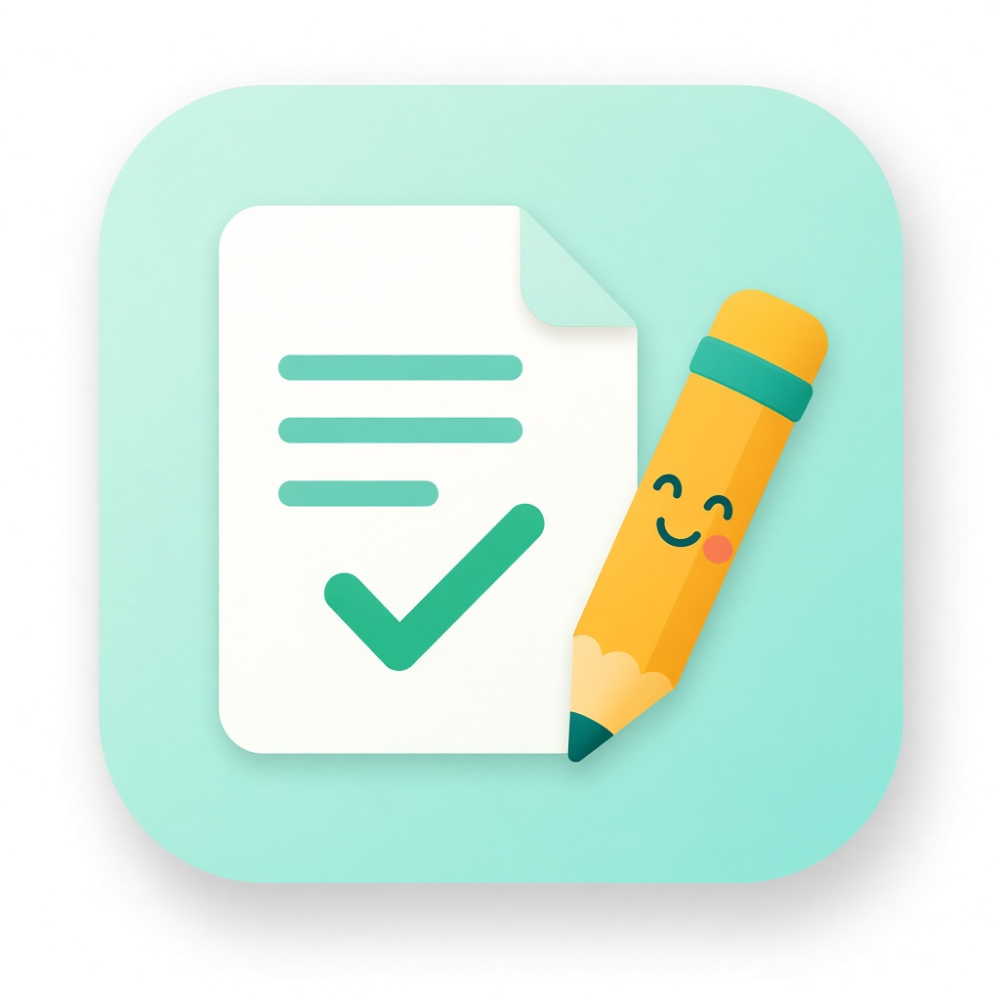

# PlainDocs

PlainDocs helps your AI assistant write guides, how-to steps, READMEs and help pages that ordinary people can actually follow. You tell it what the document is for and who will read it. It writes in everyday words, with short sentences and one step at a time, and puts warnings where readers will see them. Then it checks the draft against a simple writing checklist and tells you exactly which sentences to fix and how. Why would you want this? Confusing instructions waste people's time and cause mistakes. Clear ones save support questions and make your project friendlier. It's free.

## Project status: done, pending, uncertain
**Done**
- 2026-10-22: v1.0.0 built and pushed to GitHub. Local tests: manifest valid JSON and valid against Cursor's plugin schema, skill and rule front matter valid (`tests/check_frontmatter.py`), and `tests/test_checker.py` confirms the checker flags the "before" example and passes the "after" example.

**Pending**
- Not tested inside Cursor or Grok yet (no in-app test has been done).
- Not submitted to the marketplace.
- Translated summaries are machine-made and not reviewed by native speakers.

**Uncertain**
- How well each AI host follows the checklist on very long documents.

## Quick start
1. Install (see Installation).
2. Ask: "Write a plain-language README for my photo-backup script for people who have never used a terminal."
3. Then ask: "Check this help page with PlainDocs."

## Installation
Install from this repository: https://github.com/OmnipotentCEOxJenny/plaindocs (Cursor plugin format: `.cursor-plugin/plugin.json`, `skills/`, `rules/`). Free. No API keys, no accounts, no paid services. The optional checker needs only Python 3 (standard library).

## Testing
1. `python3 tests/check_frontmatter.py` (needs PyYAML).
2. `python3 tests/test_checker.py`. Expected: PASS (the "before" example is flagged; the "after" example has no issues).
3. Compare with `examples/worked-example.md`.

## Search keywords
PlainDocs, JennyEcho, OmnipotentCeo, readme, readmes, guides, explainer, instructions, manuals, manual, faq, faqs, docs, writing, rewriting, rewrite, readability, clarity, concise, conciseness, jargon, wordiness, sentences, paragraphs, headings, checklist, editing, revision, proofread, style, copyediting, usability, onboarding, tutorials, walkthrough, steps, warnings, simplify, comprehension, simplicity. The full list with plain-word meanings is in [keywords.md](keywords.md).

## Credits
- Inventor and publisher: Rob Domaine / Omnipotent Media LLC
- Builder: Jenny Echo
- Checklist and guidance drawn from two free open textbooks Jenny Echo studied:
  - Suzan Last, *Technical Writing Essentials: Introduction to Professional Communications in the Technical Fields*, University of Victoria, 2019, CC BY 4.0 (the seven Cs, the revision checklist, and section 7.7 "Writing Instructions").
  - Sam Schechter and Nathan Hall, *Professional Writing in the Digital Age*, 2026, CC BY-NC-SA 4.0 (the seven Cs with clarity first, the steps for concise writing, and stating limits honestly).
- The checklist is summarized in our own words; no text is copied at length. PlainDocs is independent and not endorsed by the authors.

## Rob Domaine's four pillars
1. Trustworthy, honest, real data, truthful: never invent features, steps or facts; unknowns are marked TO CONFIRM.
2. Use only legitimate means: write from the user's own material and properly credited sources.
3. Double-check everything: every document is checked against the checklist before it is called done.
4. Stay within the law and rules always: local, county, state, federal and platform rules.

## Components
- `skills/plaindocs-write`: write a plain-language document for a named reader.
- `skills/plaindocs-check`: check a document against the checklist and suggest fixes.
- `rules/pillars-and-scope.mdc`: the pillars and scope.
- `scripts/plaindocs_check.py`: an optional automatic first pass (standard library only).
- `examples/`: a real before-and-after example.
- `tests/`: front-matter check and functional checker test.
- `keywords.md`: the search keyword list.

## Languages
The AI answers in the user's language and keeps commands, file names and code unchanged. Summaries in 23 languages are in [TRANSLATIONS.md](TRANSLATIONS.md). They are machine translations, not yet reviewed by native speakers; the English text is authoritative. The automatic checker's word lists are English only.

## License
MIT. See `LICENSE`.

## Honest assessment: what this plugin cannot do
- It has not been tested inside Cursor or Grok yet; only local tests on one computer have been run.
- It cannot check whether your facts are right. It only checks how clearly they are written, so you must confirm accuracy.
- The automatic checker is a rough English-only heuristic. It can miss problems and can flag sentences that are fine.
- It cannot replace testing your instructions with real readers, which is still the best way to find gaps.
- Marketplace: not submitted; it is not an approved listing.
- Translations are machine-made and not reviewed by native speakers.
- It is not legal advice and does not make documents legally compliant.
- Rules and compliance: it follows all local, county, state and federal laws and every platform's rules, uses no paid services, never bypasses logins or security settings, and never claims a feature it does not have.
